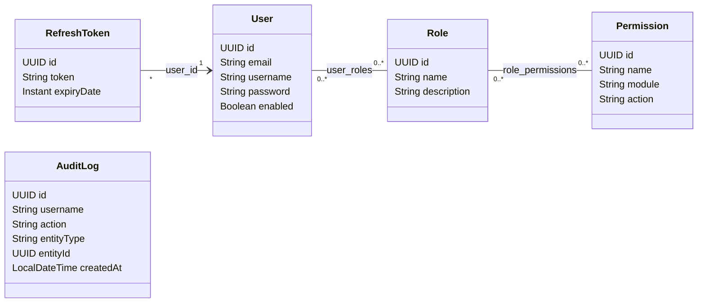
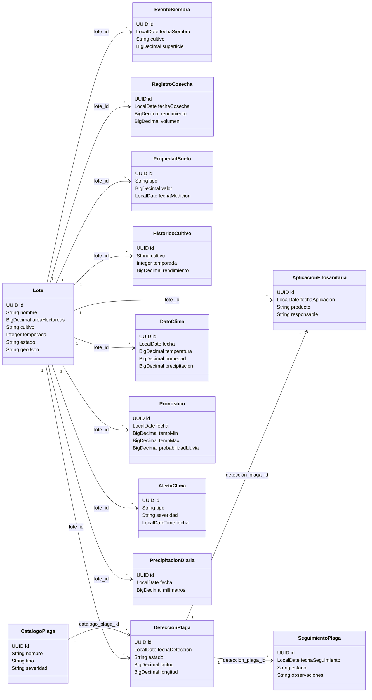
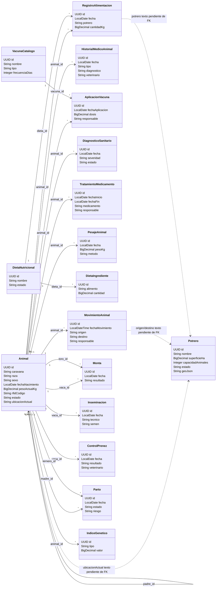
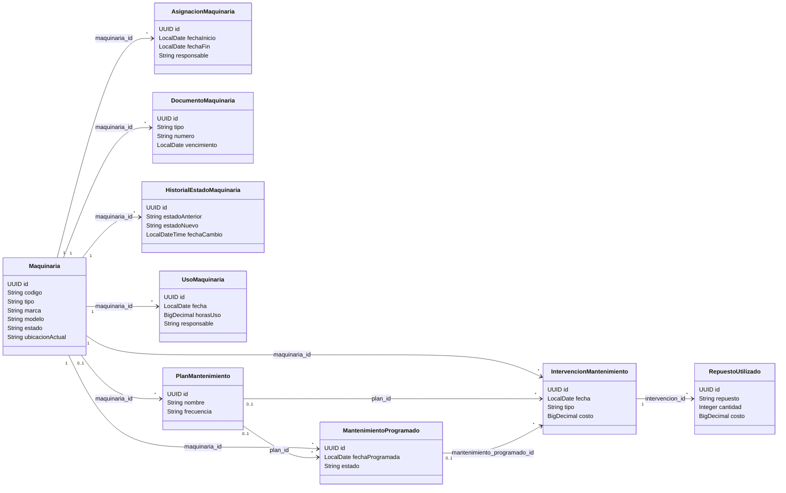
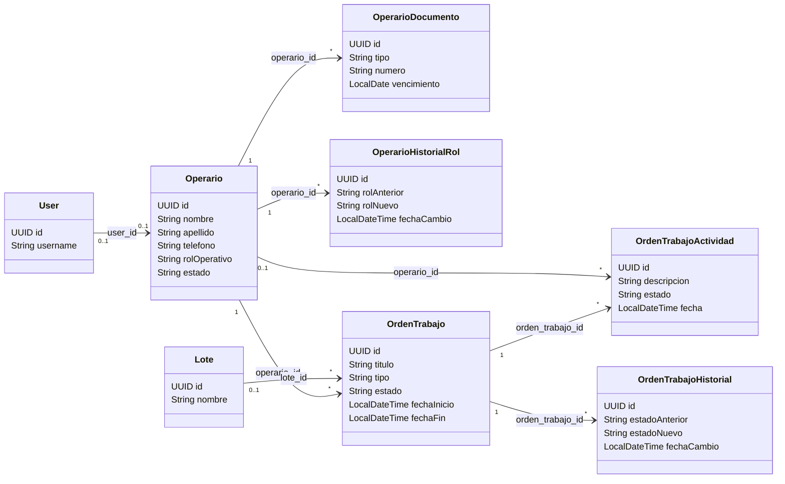
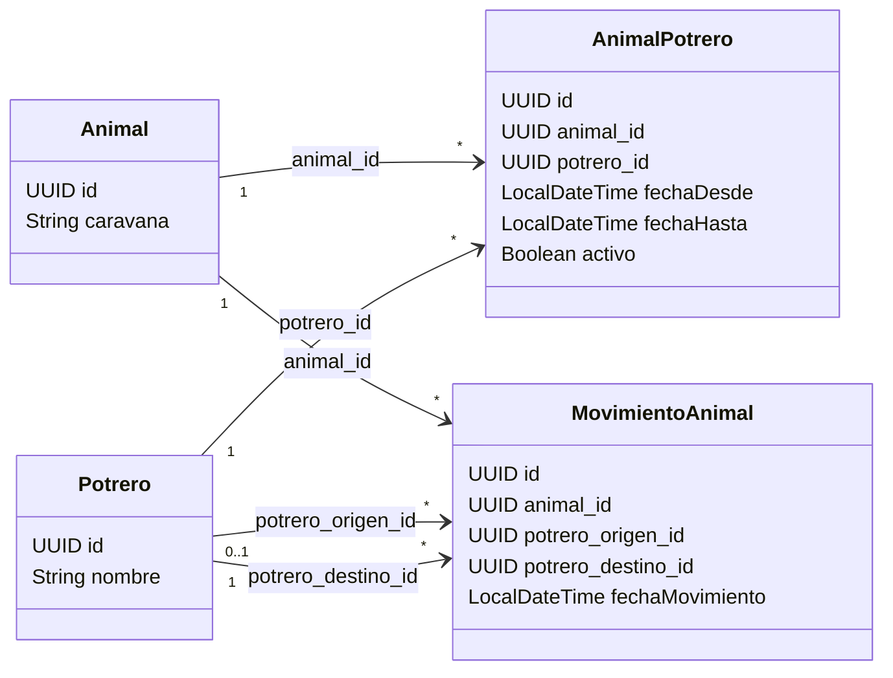

# UML de entidades Java - Campo App

Fecha de relevamiento: 2026-06-09

Este documento refleja el estado actual de las entidades Java/JPA del sistema. No representa el modelo ideal final de integridad referencial definido en la feature 43, sino la estructura que existe hoy en el codigo.

## Leyenda

- `-->` relacion por FK/JPA existente.
- `--` relacion many-to-many por tabla intermedia.
- `..>` relacion pendiente o deuda tecnica detectada.
- Los atributos listados son los mas relevantes para entender la estructura, no todos los campos de cada entidad.

## Seguridad, usuarios y roles

## Agricultura, clima y plagas

## Ganaderia

## Maquinaria

## Operarios y ordenes de trabajo

## Integridad referencial implementada por feature 43

La feature 43 corrige el vinculo operativo entre animales y potreros para que la ubicacion actual salga de una relacion por ID y no de un nombre textual.

Reglas implementadas por feature 43:

- Toda relacion entre entidades debe resolverse por FK/ID, no por nombre textual.
- Un animal debe estar asignado a un potrero mediante una tabla relacional como `animal_potrero`.
- Un movimiento de animal debe cerrar la asignacion activa anterior y crear una nueva asignacion activa en destino.
- Los reportes y dashboards deben agrupar por `potrero_id` y luego mostrar `potrero.nombre`.
- El mismo criterio queda como regla transversal para responsables, veterinarios, operarios, maquinaria, lotes, potreros e insumos.
